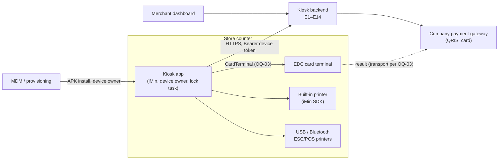
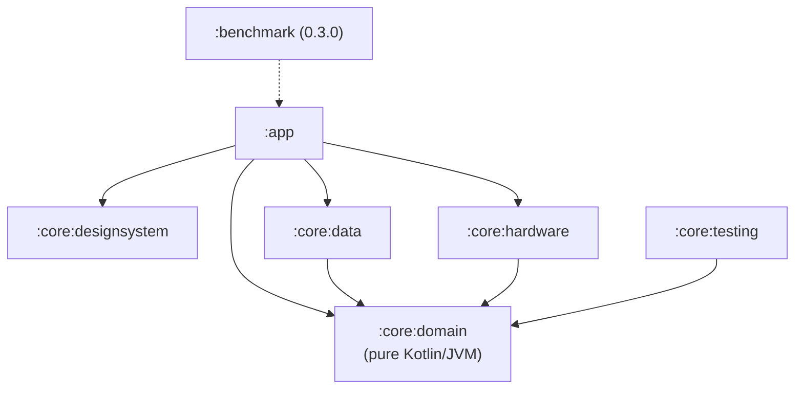
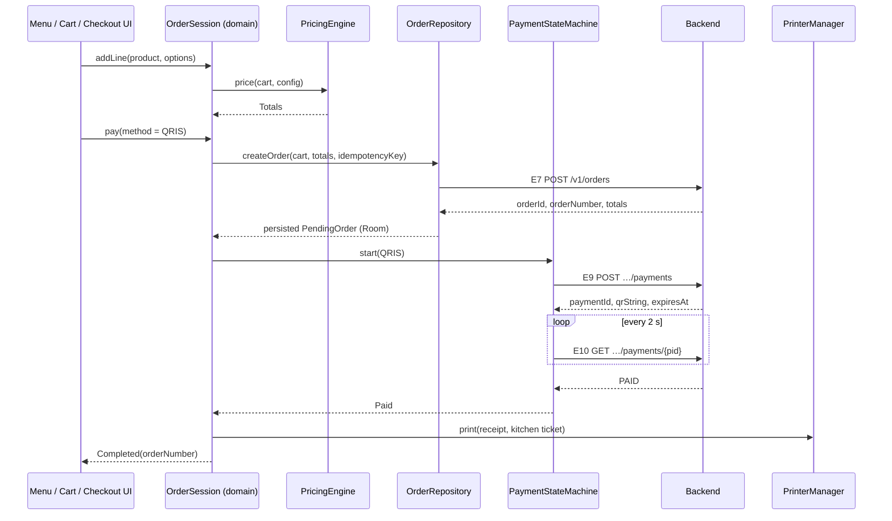
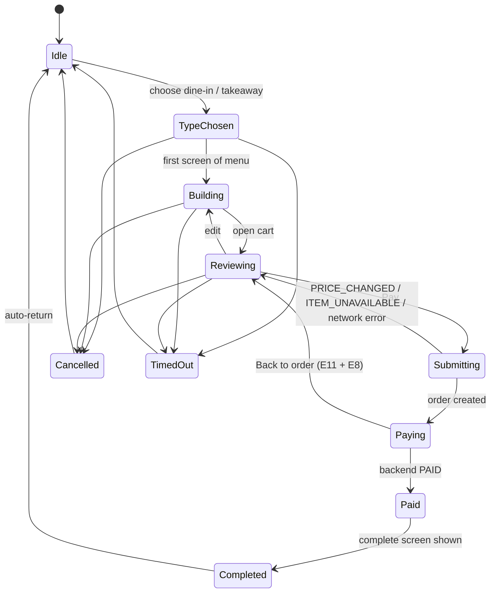
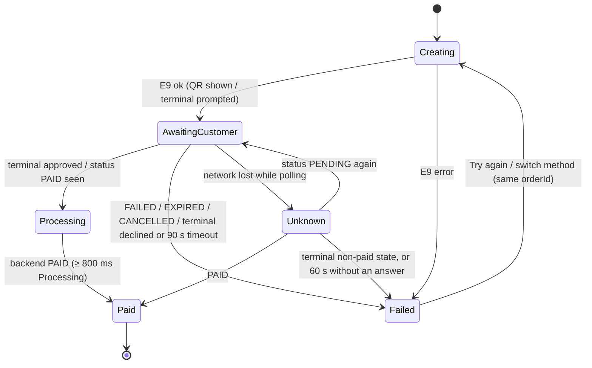

# Hitachi Kiosk — Architecture

| | |
|---|---|
| Document version | 1.0 (2026-10-22) |
| Requirements | [`prd.md`](prd.md): this document explains *how*; the PRD decides *what*. Where they disagree, the PRD wins. |
| Contract | [`api/api-spec.md`](api/api-spec.md) (E1–E14) |
| Plan / tests | [`dev-plan.md`](dev-plan.md), [`testing-plan.md`](testing-plan.md) |
| Decisions | [`adr/`](adr/): ADR-0001 records the stack and module choice |

## 1. Overview and constraints

An Android self-order kiosk app for an iMin kiosk. It runs in lock-task mode as device owner and is used by customers (ordering, paying) and store staff (settings). It talks to one backend that we specify ourselves. That backend fronts the company payment gateway.

Constraints that shape every choice below:

- **One developer working with AI agents, ~3 months** [D-25]. The structure has few modules and has to be easy to test, not "enterprise".
- **Contract-first** [D-06]. No backend exists yet. Every external system sits behind an interface with a fake (NFR-012), so the whole app runs on an emulator.
- **Offline browse only** [D-11]. The menu is cached. Checkout needs connectivity. There is no offline order queue.
- **Money is never "paid" on the device's word** [A-15]. Only the backend's `PAID` status completes an order.
- **Server time for business timestamps** (NFR-017). The local clock only drives UI timers.
- **Platform**: `minSdk 30`, Kotlin, Jetpack Compose, portrait 1080 × 1920 (NFR-001, NFR-002).

## 2. System context



The kiosk never talks to the gateway directly. QRIS payloads and payment status come through the backend (E9–E11). If the EDC reports its result to the kiosk rather than to the gateway, the kiosk relays it through E12 (OQ-03).

## 3. Modules

Defined in PRD §12.1 and recorded in [ADR-0001](adr/0001-architecture.md).



| Module | Holds | May depend on | Must not |
|---|---|---|---|
| `:app` | `MainActivity`, nav graph, feature packages, ViewModels, Hilt wiring, lock task, debug Developer options (`src/debug`) | all core modules | Contain business rules (pricing, plan search, state transitions) |
| `:core:designsystem` | Tokens, `DesignUnit`, typography, motion specs, shared components (PRD §11.3), CompositionLocals | Compose only | Know about domain models; components take plain parameters |
| `:core:domain` | Models, `PricingEngine`, `Cart`, `BudgetPlanner`, `OrderSession`, `PaymentStateMachine`, repository and device interfaces, `Clock` | Kotlin stdlib, coroutines | Import `android.*`, Retrofit, Room or Hilt. Enforced by being a JVM module |
| `:core:data` | Retrofit API, DTOs + mappers, Room, DataStore, token store, repositories, sync worker, `ConnectivityMonitor` | `:core:domain` | Leak DTOs or Room entities out of the module |
| `:core:hardware` | `DeviceIdentityProvider`, `PrinterManager` + drivers, receipt/ticket renderers, `CardTerminal` impls | `:core:domain` | Depend on `:core:data` |
| `:core:testing` | Scriptable fakes, fixtures (menu sample from `api-spec.md` §4), test rules | `:core:domain` | Ship in release (used by `testImplementation`, `androidTestImplementation` and the `debug` source set only) |

**Feature packages in `:app`** (`com.hitachi.kiosk.feature.*`): `splash`, `activation`, `merchant`, `idle`, `ordertype`, `menu`, `item`, `combo`, `budget`, `upsell`, `cart`, `checkout`, `complete`, `inactivity`, `settings`. A feature package never imports another feature package. Shared flow state goes through the domain session (§5), not through ViewModel-to-ViewModel calls.

## 4. Layering and data flow

```
Compose Screen  ──events──►  ViewModel  ──calls──►  domain (session, engines, repo interfaces)
      ▲                         │                              ▲
      └──── StateFlow<UiState> ─┘                              │ implemented by
            + one-off effects                         :core:data / :core:hardware
```

- **UI**: stateless `XxxScreen(state, onEvent)` composables plus a thin `XxxRoute` that collects from the ViewModel. Previews and screenshot tests use the stateless screen.
- **ViewModel**: exposes one `StateFlow<XxxUiState>`, takes `XxxEvent`s through `onEvent(event)`, and emits one-off `XxxEffect`s (navigate, play sound) through a `Channel` read as a `Flow`. It maps domain state to UI state and holds no business rules.
- **Domain**: pure functions and state machines. Use-case classes only exist where they combine more than one repository. Otherwise ViewModels call the session or repository directly.
- **Data/hardware**: implement domain interfaces, map DTOs to domain models, and turn transport errors into `DomainError` (§13.3).

### 4.1 Journey J1 (dine-in, QRIS) through the layers



## 5. Order and payment state

Both machines live in `:core:domain`. They are plain Kotlin classes that expose `StateFlow<State>` and accept intents. They are unit-tested exhaustively (≥ 90 % coverage, NFR-011).

### 5.1 OrderSession (PRD §12.2, DEV-041)



- **Owner**: one `OrderSession` per order, held by an app-scoped `OrderSessionHolder` (Hilt `@Singleton`). Feature ViewModels read it and send intents to it. This is how Menu, Item, Combo, Budget Pas and Cart share one cart without passing it through navigation arguments.
- **Inactivity** (FR-023) is a separate `InactivityController` that watches the session state and touch events. It is suspended in `Paying`, `Paid` and staff settings.
- **Menu snapshot**: the session captures the catalog version at `TypeChosen`. A sync that lands mid-order is applied when the session returns to `Idle` (FR-028, A-29).

### 5.2 PaymentStateMachine (DEV-047)



- "You have not been charged" only renders from `Failed` reached via a backend terminal non-paid status, never from `Unknown` or a timeout without a backend answer (FR-019).
- QR expiry is computed from server `expiresAt` minus a server/device offset measured on the E9 response `Date` header (NFR-017).
- Polling stops on any terminal state (FR-017 AC5).

### 5.3 Process-death recovery (FR-016, DEV-052)

`PendingOrder {orderId, orderNumber, paymentId?, method?, idempotencyKey, totals, createdAt}` is written to Room when E7 succeeds and updated at E9. `StartupRouter` checks it before routing:

| Stored state | Action on restart |
|---|---|
| None | Normal routing (FR-001) |
| Order, no payment | E8 cancel, clear, Idle |
| Payment present | E10 status → `PAID`: Complete + print. `PENDING`: resume Checkout. Otherwise: E8 cancel, clear, Idle |

Everything else in a customer session is deliberately lost on process death [A-11].

## 6. Persistence

| Data | Store | Notes |
|---|---|---|
| Device token | Secure DataStore `secure.pb` behind `TokenStore`: Tink AEAD (AES-256-GCM) serializer, keyset wrapped by an Android Keystore key (NFR-005, ADR-0001) | Cleared on 401 or Log out. If the Keystore key is lost (e.g. device restore), decryption fails → treat as not activated (FR-001) |
| deviceId, merchant binding, kiosk name/code | DataStore `device.preferences_pb` | Not secret |
| Device settings (order types, timeout, printers + roles, toggles, QR expiry, rounding) | DataStore `settings.preferences_pb` | Exposed as `Flow<KioskSettings>` |
| Merchant config (E5) + ETag | Room `config` | Includes the staff PIN hash (`staffPin`, verified offline, FR-024) |
| Menu (E6) + ETag + `menuVersion` | Room `category`, `product`, `modifier_group`, `option`, `combo`, … | Replaced in one transaction (DEV-021) |
| Pending order/payment | Room `pending_order` | §5.3 |
| PIN lockout counter and until-time | DataStore | Survives restart (FR-024) |
| Images | Coil disk cache, 200 MB [A-37] | |
| Logs | Rotating files in `filesDir/logs`, 10 MB / 7 days (FR-031) | Redacted (§13.2) |

Upgrades (NFR-014): Room uses explicit `Migration`s from 1.0.0 onward, with `exportSchema = true` and schemas committed under `core/data/schemas/`. Before 1.0.0, destructive migration is allowed for the cache tables only, never for `pending_order` or DataStore.

## 7. Networking

- **Stack**: Retrofit + OkHttp + kotlinx.serialization (`ignoreUnknownKeys = true`, `explicitNulls = false`). One `KioskApi` interface mirrors E1–E14.
- **Base URL**: `BuildConfig.API_BASE_URL` per flavor-less build config `dev | staging | prod` (DEV-007). The debug Developer options can override it at runtime.
- **Interceptors**, in order: `Idempotency-Key` (mutating calls take a key from the caller, never generated inside the interceptor, so a retry reuses it) → auth (`Bearer`) → `Accept-Language` / app version headers → logging (debug only, redacted).
- **Errors**: the response envelope `{code, message, details}` is parsed into `ApiError` and mapped to `DomainError` in the repository. HTTP 401 on any authenticated call → `SessionInvalidator` clears token and binding and routes to SCR-02.
- **Timeouts and retries** (NFR-010): connect 10 s, read 15 s. Retries (1 s, 2 s, 4 s) only for GETs and for mutations that carry an Idempotency-Key. Retries are written in the repository, not as an OkHttp interceptor, so they stay visible and testable.
- **Caching**: E5 and E6 send `If-None-Match`. A 304 keeps the Room copy.
- **Security** (NFR-005): cleartext disabled via `network_security_config.xml`. Certificate pinning is configured in OkHttp `CertificatePinner` with a primary and a backup pin, for `staging`/`prod` only [A-36].
- **Threading**: suspend functions. Dispatchers are injected (`@IoDispatcher`), never hard-coded.

## 8. Sync and offline

- `CatalogSyncRepository.sync()` fetches E5 then E6 and writes both atomically. It runs on binding, on startup (non-blocking after the 10 s splash cap), on "Sync now", on reconnect, and every 15 min through a `CoroutineWorker` with a `CONNECTED` constraint (DEV-022/023).
- After a sync, product images are pre-fetched into the Coil disk cache.
- `ConnectivityMonitor` (DEV-051) combines `ConnectivityManager` validated-network callbacks with an E14 health probe into `StateFlow<Connectivity>`. The checkout gate and the offline banner both read only this flow (FR-028).

## 9. Hardware abstraction

All interfaces live in `:core:domain`. Real implementations live in `:core:hardware`, and fakes in `:core:testing`.

| Interface | Real implementations | Fake can simulate |
|---|---|---|
| `DeviceIdentityProvider` | iMin SDK → `Build.getSerial()` (device owner) fallback (FR-002, ADR-0002) | success, unavailable, slow |
| `PrinterManager` / `PrinterDriver` | `IminPrinterDriver`, `UsbEscPosDriver` (bulk transfer), `BtEscPosDriver` (SPP) (FR-022, ADR-0004) | ready, offline, out of paper, fails mid-job |
| `ReceiptRenderer` | Pure Kotlin: domain order → ESC/POS command list (58/80 mm) | n/a (unit-tested directly) |
| `CardTerminal` | Adapter per OQ-03 (ADR-0003) | approved, declined, timeout, cancelled |
| `ConnectivityMonitor` | §8 | online, offline, flapping |
| `Clock` | `SystemClock` wrapper | controllable time |

The receipt renderer produces a device-independent command list, and each driver only transports bytes. That way receipts can be checked in unit tests without hardware.

**Real vs fake selection**: Hilt modules in `:app` bind real implementations. In the `debug` source set, a `DebugBindingsModule` replaces them with switchable wrappers (`SwitchableCardTerminal` etc.) that delegate to either the real implementation or the fake, based on the Developer options choice (DEV-009). Release builds contain neither the wrappers nor the fakes (checked with `apkanalyzer` in CI).

## 10. Dependency injection

Hilt. One `@Module` per concern, installed in `SingletonComponent` unless stated otherwise:

- `:core:data`: `NetworkModule`, `DatabaseModule`, `DataStoreModule`, `RepositoryModule` (`@Binds` interface → implementation).
- `:core:hardware`: `HardwareModule`.
- `:app`: `DispatchersModule` (`@IoDispatcher`, `@DefaultDispatcher`), `SessionModule` (`OrderSessionHolder`), `ClockModule`.
- `:core:domain` has no Hilt. Its classes use plain constructors, and modules in `:app` or `:core:data` provide them.

Tests: unit tests construct classes by hand with fakes. Instrumented tests use `@TestInstallIn` to swap modules for fakes.

## 11. Navigation

- Single `MainActivity`, portrait-locked, `FLAG_KEEP_SCREEN_ON`, edge-to-edge with system bars hidden in lock task.
- Navigation Compose with type-safe `@Serializable` route objects, one per screen SCR-01…SCR-19 (PRD §4). SCR-13 ("Still there?") is an overlay hosted above the `NavHost`, not a route.
- The **start destination is always Splash**. `StartupRouter` (DEV-011) waits for both the 3.9 s minimum and initialization (≤ 10 s network cap), then replaces the back stack with SCR-02, SCR-03 or SCR-04 (FR-001).
- The customer flow is a nested graph. Leaving it (Complete auto-return, timeout, cancel) pops to Idle and resets the session.
- Staff settings are a nested graph entered only through the PIN gate (SCR-14), with their own 120 s timeout [A-22].
- System Back is disabled on customer screens except where the design shows a Back control.

## 12. Design system

- **Units**: `DesignUnit` gives `Int.dpx` / `Int.spx` = value × `screenWidthDp / 1080`, with `spx` multiplied by 1.15 when Larger text is on (PRD §11.2). Every layout dimension in feature code uses `dpx`/`spx`, never raw `dp`/`sp`.
- **Tokens**: `KioskColors`, `KioskType`, `KioskShapes`, `KioskSpacing` provided through `KioskTheme`. Material 3 is the foundation only. Feature code reads `KioskTheme.*`, not `MaterialTheme.*`.
- **Accent**: `LocalAccent` is set from merchant config `accentColor` at the theme root [A-38].
- **Motion**: named easings (`Emphasized`, `Press`, `Spring`, `InOut`, `Fly`) and per-screen duration constants mirror PRD §11.4. `LocalReduceMotion = true` turns every spec into `snap()` (DEV-004).
- **Components** (PRD §11.3) take plain parameters and lambdas, never ViewModels or domain types, so they can be previewed and screenshot-tested alone.

## 13. Cross-cutting concerns

### 13.1 Localization
- `values/strings.xml` (en) and `values-in/strings.xml` (id). No hardcoded user-visible text (NFR-008).
- Per-order language (FR-008) uses an app-level `LocaleController`. Whether it is backed by `AppCompatDelegate.setApplicationLocales` or a Compose-local `Configuration` override is decided in DEV-026 and recorded as an ADR. Settings use the default language [A-06].
- Menu text is `LocalizedText {en, id}` in the domain, resolved in the UI layer.
- Money formatting goes through `IdrFormatter` (BR-01), not `NumberFormat` locale defaults.

### 13.2 Logging and privacy
- `KioskLog` facade → rotating file sink (FR-031) + Logcat in debug. No third-party crash or analytics SDK [D-23].
- Redaction is applied in the facade: PIN never logged, payment references truncated to the last 4 characters, no customer data (NFR-006).

### 13.3 Errors
`DomainError` is a sealed hierarchy that every repository returns through `Result`-style `Outcome<T>`:
`Network` (offline/timeout), `Unauthorized`, `PriceChanged(details)`, `ItemUnavailable(ids)`, `Conflict`, `Server(code)`, `Hardware(device, reason)`, `Unknown`. ViewModels map each case to copy from the PRD. Exceptions never cross a module boundary.

### 13.4 Concurrency
Coroutines and Flow only. `viewModelScope` for UI work. An app-scoped `@ApplicationScope CoroutineScope` for the session, sync and print jobs that must outlive a screen. No `GlobalScope`, no `runBlocking` outside tests.

## 14. Kiosk lockdown (FR-029, DEV-071)

- `KioskDeviceAdminReceiver` is declared in the manifest. When `DevicePolicyManager.isDeviceOwnerApp` is true, `KioskModeController` calls `setLockTaskPackages`, sets `MainActivity` as the persistent preferred home activity, disables keyguard and status bar, then `startLockTask()` after merchant binding.
- `BootReceiver` (`RECEIVE_BOOT_COMPLETED`) relaunches the app.
- When not device owner (dev devices), it falls back to screen pinning and Settings home shows a warning.
- "Exit kiosk mode" calls `stopLockTask()` behind the PIN. Provisioning steps (OQ-10) go into `docs/provisioning.md` (DEV-101).

## 15. Testing architecture

Summary only. [`testing-plan.md`](testing-plan.md) is authoritative.

| Level | Where | Tools | Targets |
|---|---|---|---|
| Unit (JVM) | `:core:domain`, `:core:data`, `:core:hardware` (renderers), ViewModels | JUnit 4, Truth, kotlinx-coroutines-test, Turbine, MockWebServer, Room in-memory (Robolectric) | domain ≥ 90 %, data ≥ 70 % (Kover) |
| Screenshot | `:core:designsystem`, feature screens | Roborazzi (JVM) at 1080 × 1920 @ 160/240/320 dpi | NFR-002, NFR-009 |
| Instrumented UI | `:app` `androidTest` | Compose UI test, Hilt test modules with fakes | Journeys J1–J9 |
| Performance | `:benchmark` | Macrobenchmark, baseline profile, JankStats | NFR-003 |
| Hardware / soak | target iMin device | manual + UI Automator script | NFR-004, NFR-016 |

Contract tests: MockWebServer fixtures are loaded from the examples in `api-spec.md`, so a spec change that breaks parsing fails CI (DEV-006).

## 16. Open architectural questions

| Question | Affects | Resolution |
|---|---|---|
| OQ-01 iMin model, SN API, printer SDK | `DeviceIdentityProvider`, `IminPrinterDriver` | ADR-0002 (0.2.0), ADR-0004 (0.6.0) |
| OQ-03 EDC transport and result path | `CardTerminal` impl, whether E12 is used | ADR-0003 (0.5.0) |
| OQ-02 Gateway spec | Backend only, unless push replaces polling | ADR-0003 |
| OQ-10 Provisioning method | Lock task, install | `docs/provisioning.md` (DEV-101) |
| Locale switching mechanism | `LocaleController` | ADR during DEV-026 |
