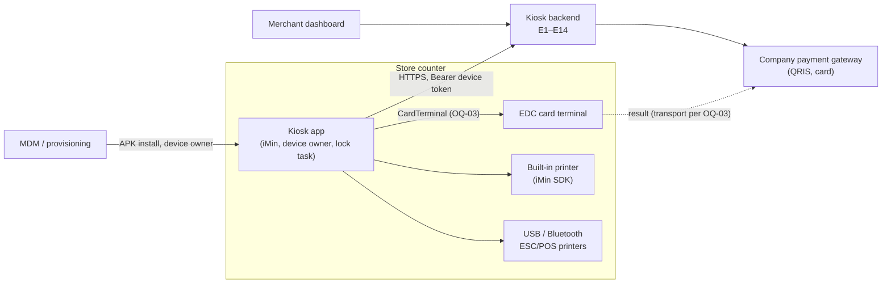
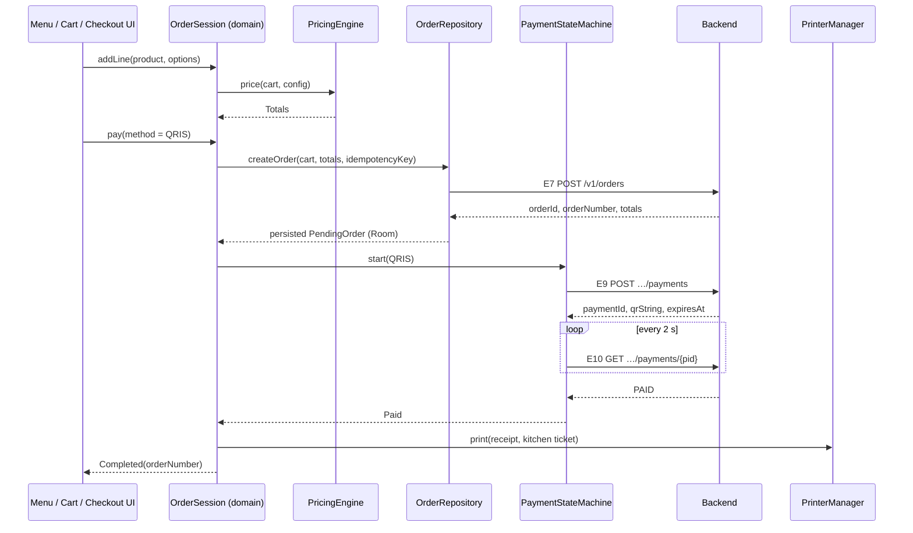
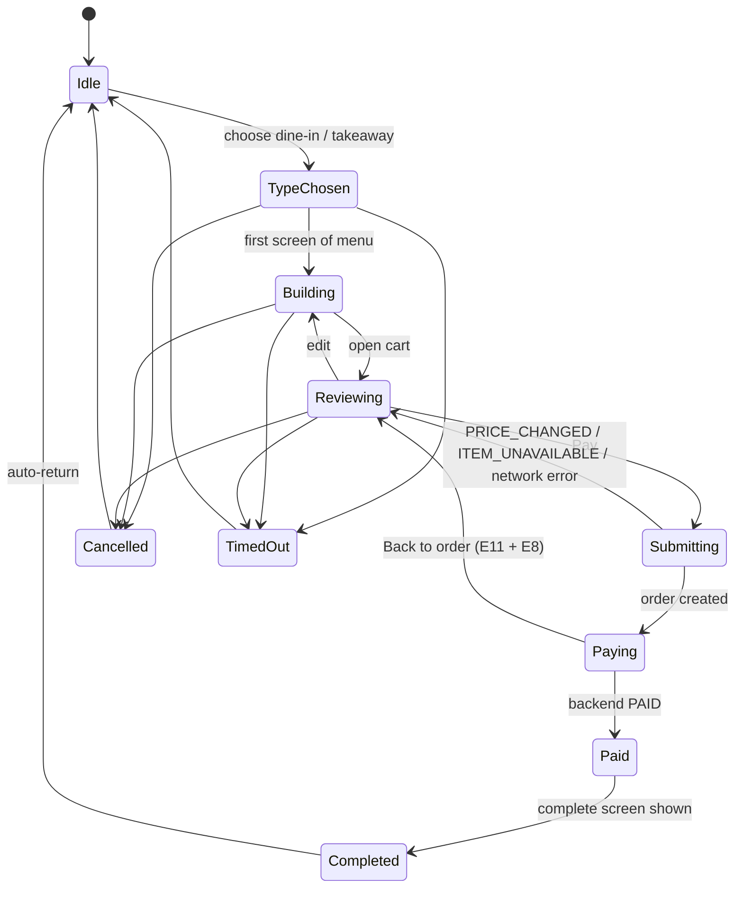
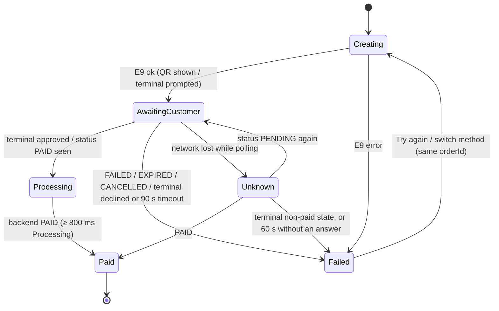

# Hitachi Kiosk — Architecture

| | |
|---|---|
| Document version | 1.3 (2026-10-23) — catalog cache and sync, order session holder, connectivity and image cache as built in 0.3.0 |
| Requirements | [`product-requirement.md`](product-requirement.md): this document explains *how*; the PRD decides *what*. Where they disagree, the PRD wins. Measurable technical requirements: [`technical-requirement.md`](technical-requirement.md). |
| Implementation | [`technical-design.md`](technical-design.md) adds the implementation detail (build, schemas, algorithms, configuration) under this structure. [`technology-stack.md`](technology-stack.md) pins the libraries and versions. |
| Contract | [`api/api-spec.md`](api/api-spec.md) (E1–E14) |
| Plan / tests | [`dev-plan.md`](dev-plan.md), [`testing-plan.md`](testing-plan.md) |
| Decisions | [`adr/`](adr/): ADR-0001 records the stack and module choice |
| Design | [`ui-design/`](ui-design/): the final "Linen & Paprika" design. `S_<Screen>_<scenario>` boards are the visual spec for every non-default state. |

## 1. Overview and constraints

An Android self-order kiosk app for an iMin kiosk. It runs in lock-task mode as device owner and is used by customers (ordering, paying) and store staff (settings). It talks to one backend that we specify ourselves. That backend fronts the company payment gateway.

Constraints that shape every choice below:

- **One developer working with AI agents, ~3 months** [D-25]. The structure has few modules and has to be easy to test, not "enterprise".
- **Contract-first** [D-06]. No backend exists yet. Every external system sits behind an interface with a fake (NFR-012), so the whole app runs on an emulator.
- **Offline browse only** [D-11]. The menu is cached. Checkout needs connectivity. There is no offline order queue.
- **Money is never "paid" on the device's word** [A-15]. Only the backend's `PAID` status completes an order.
- **Server time for business timestamps** (NFR-017). The local clock only drives UI timers.
- **Platform**: `minSdk 30`, Kotlin, Jetpack Compose, portrait 1080 × 1920 (NFR-001, NFR-002).

## 2. System context



The kiosk never talks to the gateway directly. QRIS payloads and payment status come through the backend (E9–E11). If the EDC reports its result to the kiosk rather than to the gateway, the kiosk relays it through E12 (OQ-03).

## 3. Modules

Defined in PRD §12.1 and recorded in [ADR-0001](adr/0001-architecture.md).


| Module | Holds | May depend on | Must not |
|---|---|---|---|
| `:app` | `MainActivity`, nav graph, feature packages, ViewModels, Hilt wiring, lock task, debug Developer options (`src/debug`) | all core modules | Contain business rules (pricing, plan search, state transitions) |
| `:core:designsystem` | Tokens, `DesignUnit`, typography, motion specs, shared components (PRD §11.3), CompositionLocals | Compose only | Know about domain models; components take plain parameters |
| `:core:domain` | Models (including `DeviceState`), `PricingEngine`, `Cart`, `BudgetPlanner`, `OrderSession`, `PaymentStateMachine`, repository and device interfaces, use cases that combine repositories (`setup/ActivateKiosk`), `Clock` | Kotlin stdlib, coroutines | Import `android.*`, Retrofit, Room or Hilt. Enforced by being a JVM module |
| `:core:data` | Retrofit API, DTOs + mappers, Room, DataStore, token store, repositories, sync worker, `ConnectivityMonitor` | `:core:domain` | Leak DTOs or Room entities out of the module |
| `:core:hardware` | `DeviceIdentityProvider`, `PrinterManager` + drivers, receipt/ticket renderers, `CardTerminal` impls | `:core:domain` | Depend on `:core:data` |
| `:core:testing` | Scriptable fakes, fixtures (menu sample from `api-spec.md` §4), test rules | `:core:domain` | Ship in release (used by `testImplementation`, `androidTestImplementation` and the `debug` source set only) |

**Feature packages in `:app`** (`com.hitachi.kiosk.feature.*`): `splash`, `activation`, `merchant`, `idle`, `ordertype`, `menu`, `item`, `combo`, `budgetplan`, `upsell`, `cart`, `checkout`, `complete`, `inactivity`, `settings` (includes Change PIN). The planner itself is `BudgetPlanner` in `:core:domain` (`planner/`), and the `budgetplan` package is only its UI. A feature package never imports another feature package. Shared flow state goes through the domain session (§5), not through ViewModel-to-ViewModel calls.

## 4. Layering and data flow

```
Compose Screen  ──events──►  ViewModel  ──calls──►  domain (session, engines, repo interfaces)
      ▲                         │                              ▲
      └──── StateFlow<UiState> ─┘                              │ implemented by
            + one-off effects                         :core:data / :core:hardware
```

- **UI**: stateless `XxxScreen(state, onEvent)` composables plus a thin `XxxRoute` that collects from the ViewModel. Previews and screenshot tests use the stateless screen.
- **ViewModel**: exposes one `StateFlow<XxxUiState>`, takes `XxxEvent`s through `onEvent(event)`, and emits one-off `XxxEffect`s (navigate, play sound) through a `Channel` read as a `Flow`. It maps domain state to UI state and holds no business rules.
- **Domain**: pure functions and state machines. Use-case classes only exist where they combine more than one repository. Otherwise ViewModels call the session or repository directly.
- **Data/hardware**: implement domain interfaces, map DTOs to domain models, and turn transport errors into `DomainError` (§13.3).

### 4.1 Journey J1 (dine-in, QRIS) through the layers



## 5. Order and payment state

Both machines live in `:core:domain`. They are plain Kotlin classes that expose `StateFlow<State>` and accept intents. They are unit-tested exhaustively (≥ 90 % coverage, NFR-011).

### 5.1 OrderSession (PRD §12.2, DEV-041)



- **Owner**: one `OrderSession` per order, held by an app-scoped `OrderSessionHolder` (Hilt `@Singleton`, `SessionModule`). Feature ViewModels read it and send intents to it. This is how Menu, Item, Combo, Budget Plan and Cart share one cart without passing it through navigation arguments; routes carry only IDs (`ItemDetailRoute(productId)`, `ComboRoute(comboId?)`). Idle is the holder holding no session. Built in 0.3.0 with the states up to Building (choose or change the order type, add to the cart); DEV-041 (0.4.0) completes the machine below.
- **What the session holds**: cart lines, order type, catalog version, the `upsellShown` flag (Upsell appears once per order) and an optional `PlanTag(budget, adults, children)`. It does **not** hold a language: the 1.0 UI is English only (D-29), so there is no per-order language to reset.
- **Budget Plan hand-off**: `BudgetPlanner` is pure. The two-step screen (step 1 "Your table", step 2 "Your plan") keeps its own state in `BudgetPlanViewModel`: the current step, the Just under / Just over choice, the Customize bottom sheet, swaps, the include-sides/desserts toggles and the Strict / Up to +10% tolerance. Only when the customer taps "Add plan to order" does it send the chosen plan's lines to the session, tagged with `PlanTag`. Payment reads the tag to show the "Budget Plan" row. Editing or removing those lines in the cart clears the tag.
- **Inactivity** (FR-023) is a separate `InactivityController` that watches the session state and touch events. It is suspended in `Paying`, `Paid` and staff settings.
- **Menu snapshot**: the session captures the catalog version at `TypeChosen`. A sync that lands mid-order is applied when the session returns to `Idle` (FR-028, A-29).

### 5.2 PaymentStateMachine (DEV-047)



- "You have not been charged" only renders from `Failed` reached via a backend terminal non-paid status, never from `Unknown` or a timeout without a backend answer (FR-019).
- QR expiry is computed from server `expiresAt` minus a server/device offset measured on the E9 response `Date` header (NFR-017).
- Polling stops on any terminal state (FR-017 AC5).
- **Checkout screen states** map from this machine and `DomainError`: "Creating your payment…" (`Creating`), waiting (QR or card prompt, `AwaitingCustomer`), "Checking your payment…" (`Unknown`, `Processing`), and the failure variants expired, cancelled, declined, terminal timeout and offline. Every failure offers Try again, Pay by other method and Cancel order. The checkout screen has no step list, no "Step 3 of 3" indicator and no scan-line animation. Only QRIS and Card are offered (`COUNTER` hidden in 1.0, D-12a).

### 5.3 Process-death recovery (FR-016, DEV-052)

`PendingOrder {orderId, orderNumber, paymentId?, method?, idempotencyKey, totals, createdAt}` is written to Room when E7 succeeds and updated at E9. `StartupRouter` checks it before routing:

| Stored state | Action on restart |
|---|---|
| None | Normal routing (FR-001) |
| Order, no payment | E8 cancel, clear, Idle |
| Payment present | E10 status → `PAID`: Complete + print. `PENDING`: resume Checkout. Otherwise: E8 cancel, clear, Idle |

Everything else in a customer session is deliberately lost on process death [A-11].

## 6. Persistence

| Data | Store | Notes |
|---|---|---|
| Device token | Secure DataStore `secure.pb` behind `TokenStore`: Tink AEAD (AES-256-GCM) serializer, keyset wrapped by an Android Keystore key (NFR-005, ADR-0001) | Cleared on 401 or Log out. If the Keystore key is lost (e.g. device restore), decryption fails → treat as not activated (FR-001) |
| deviceId, merchant binding, kiosk name/code, operating mode (FR-005) | DataStore `device.preferences_pb` | Not secret. The binding is written only after the first config and menu download succeeds (FR-004) |
| Serial number cache (FR-002) | DataStore `identity.preferences_pb`, owned by `:core:hardware` | Keeps `:core:hardware` independent of `:core:data` (§3) |
| Device settings (order types, timeout, printers + roles, toggles, QR expiry, rounding) | DataStore `settings.preferences_pb` | Exposed as `Flow<KioskSettings>` |
| Merchant config (E5) + ETag | Room `config`, the E5 body as JSON (technical-design §6.1) | Includes the staff PIN hash (`staffPin`, verified offline, FR-024) |
| Menu (E6) + ETag + `menuVersion` | Room `menu_meta`, `category`, `product`, `product_modifier_group`, `modifier_group`, `modifier_option`, `modifier_level`, `combo`, `combo_slot_option`, `featured` | Config and menu are replaced together in one transaction (DEV-021) and wiped with the device state on Log out or HTTP 401 |
| Pending order/payment | Room `pending_order` | §5.3 |
| PIN lockout counter and until-time | DataStore | Survives restart (FR-024) |
| Images | Coil disk cache, 200 MB [A-37] | |
| Logs | Rotating files in `filesDir/logs`, 10 MB / 7 days (FR-031) | Redacted (§13.2) |

Upgrades (NFR-014): Room uses explicit `Migration`s from 1.0.0 onward, with `exportSchema = true` and schemas committed under `core/data/schemas/`. Before 1.0.0, destructive migration is allowed for the cache tables only, never for `pending_order` or DataStore.

## 7. Networking

- **Stack**: Retrofit + OkHttp + kotlinx.serialization (`ignoreUnknownKeys = true`, `explicitNulls = false`). One `KioskApi` interface mirrors E1–E14.
- **Base URL**: `BuildConfig.API_BASE_URL` per flavor-less build config `dev | staging | prod` (DEV-007). The debug Developer options can override it at runtime.
- **Interceptors**, in order: `Idempotency-Key` (mutating calls take a key from the caller, never generated inside the interceptor, so a retry reuses it) → auth (`Bearer`) → `Accept-Language` (fixed `en` in 1.0) / app version headers → logging (debug only, redacted).
- **Errors**: the response envelope `{code, message, details}` is parsed into `ApiError` and mapped to `DomainError` in the repository. HTTP 401 on any authenticated call → `SessionInvalidator` clears the token and binding through `DeviceSession`; `ActivationRepository.state` becomes `NotActivated`, and the app root (`SessionViewModel`) routes to SCR-02 from any screen.
- **Device state**: `DeviceSession` in `:core:data` is the one owner of the token, the device record, the binding and the in-memory credentials OkHttp reads. Activation, binding, Log out and the 401 handler all write through it, so they cannot disagree.
- **Timeouts and retries** (NFR-010): connect 10 s, read 15 s. Retries (1 s, 2 s, 4 s) only for GETs and for mutations that carry an Idempotency-Key. Retries are written in the repository, not as an OkHttp interceptor, so they stay visible and testable.
- **Caching**: E5 and E6 send `If-None-Match`. A 304 keeps the Room copy.
- **Security** (NFR-005): cleartext disabled via `network_security_config.xml`. Certificate pinning is configured in OkHttp `CertificatePinner` with a primary and a backup pin, for `staging`/`prod` only [A-36].
- **Threading**: suspend functions. Dispatchers are injected (`@IoDispatcher`), never hard-coded.

## 8. Sync and offline

- `CatalogSyncRepository.sync()` fetches E5 then E6 with ETags and writes both atomically. It runs on binding, on startup (in the background; the splash never waits for it, FR-001), on "Sync now", on reconnect, and every 15 min through a `CoroutineWorker` with a `CONNECTED` constraint (DEV-022/023). The reconnect, periodic and order-end triggers live in `:app`'s `CatalogSyncCoordinator`.
- A sync that lands during an order is held in memory and applied when the session returns to Idle, so the menu never changes under a customer (A-29).
- `CatalogRepository` serves the cached catalog to the customer screens from memory after one Room read, and works offline (D-11).
- After a sync, product images are pre-fetched into the Coil disk cache (200 MB, A-37).
- `ConnectivityMonitor` combines `ConnectivityManager` validated-network callbacks with an E14 health probe into `StateFlow<Connectivity>` (DEV-051). The checkout gate and the offline banner both read only this flow (FR-028). Until DEV-051 (0.5.0) it follows the validated network only (technical-design §7.3, TD-12).

## 9. Hardware abstraction

All interfaces live in `:core:domain`. Real implementations live in `:core:hardware`, and fakes in `:core:testing`.

| Interface | Real implementations | Fake can simulate |
|---|---|---|
| `DeviceIdentityProvider` | `IminDeviceIdentityProvider`: the system properties the iMin SDK reads (`ro.serialno`, `persist.sys.imin.sn`) and other candidates → `Build.getSerial()` (device owner + `READ_PHONE_STATE`, pending PO approval), cached (FR-002, ADR-0002) | success, unavailable, slow |
| `PrinterManager` / `PrinterDriver` | `IminPrinterDriver`, `UsbEscPosDriver` (bulk transfer), `BtEscPosDriver` (SPP) (FR-022, ADR-0004) | ready, offline, out of paper, fails mid-job |
| `ReceiptRenderer` | Pure Kotlin: domain order → ESC/POS command list (58/80 mm) | n/a (unit-tested directly) |
| `CardTerminal` | Adapter per OQ-03 (ADR-0003) | approved, declined, timeout, cancelled |
| `ConnectivityMonitor` | `DefaultConnectivityMonitor` (`:core:data`), §8 | online, offline, checking, flapping |
| `Clock` | `SystemClock` wrapper | controllable time |

The receipt renderer produces a device-independent command list, and each driver only transports bytes. That way receipts can be checked in unit tests without hardware.

**Real vs fake selection**: Hilt modules in `:app` bind real implementations. They also declare optional `BindingOverrides`, which only the `debug` source set provides: it wraps the real implementations in switchable wrappers (`SwitchableBackendApi` in 0.1.0, `SwitchableDeviceIdentityProvider` in 0.2.0, then `SwitchableCardTerminal` etc.; `ConnectivityMonitor` has an override since 0.3.0 that debug builds leave real and instrumented tests replace with a fake) that delegate to either the real implementation or the fake, based on the Developer options choice (DEV-009, technical-design §4.3 TD-11). Release builds contain neither the wrappers nor the fakes (checked in the dex files and the R8 mapping by `scripts/check-release-apk.sh`, part of `./gradlew verify`).

## 10. Dependency injection

Hilt. One `@Module` per concern, installed in `SingletonComponent` unless stated otherwise:

- `:core:data`: `NetworkModule`, `DataStoreModule`, `RepositoryModule` (`@Binds` interface → implementation, plus `UnauthorizedHandler` → `SessionInvalidator`, the catalog cache and `CatalogSyncScheduler`), and `DatabaseModule` (Room, from 0.3.0). DataStore instances are process-wide (one per file), outside the Hilt graph. The `CatalogSyncWorker` is a `@HiltWorker`.
- `:core:hardware`: `HardwareModule`.
- `:app`: `CoroutinesModule` (`@IoDispatcher`, `@DefaultDispatcher`, `@ApplicationScope`), `ClockModule` (`Clock`, `IdGenerator`), `BackendModule` (`ApiConfig`, `BackendApi` and `PaymentGateway` → `:core:data` implementations, optional debug overrides), `HardwareBindingsModule` (`DeviceIdentityProvider` → `:core:hardware` and `ConnectivityMonitor` → `:core:data`, each with its optional override), `SetupModule` (`ActivateKiosk`, `@VersionName`, `ZoneId`), and from 0.3.0 `SessionModule` (`OrderSessionHolder`, `ImagePrefetcher` → Coil). `KioskApp` is the WorkManager `Configuration.Provider` (`HiltWorkerFactory`) and Coil's `SingletonImageLoader.Factory`. `src/debug` adds `DeveloperOptionsModule`.
- `:core:domain` has no Hilt. Its classes use plain constructors, and modules in `:app` or `:core:data` provide them.

Tests: unit tests construct classes by hand with fakes. Instrumented tests use `@TestInstallIn` to swap modules for fakes.

## 11. Navigation

- Single `MainActivity`, portrait-locked, `FLAG_KEEP_SCREEN_ON`, edge-to-edge with system bars hidden in lock task.
- Navigation Compose with type-safe `@Serializable` route objects, one per screen SCR-01…SCR-20 (PRD §4), including Upsell and Budget Plan (SCR-19, one route with an internal step state, so Back from step 2 returns to step 1 and Back from step 1 returns to Menu). Change PIN (SCR-20) is a route inside the staff settings graph. SCR-13 ("Still there?") is an overlay hosted above the `NavHost`, not a route. The design shows it as its own board with Menu blurred behind it.
- The **start destination is always Splash**. `StartupRouter` (DEV-011) waits for both the 3.9 s minimum and initialization (≤ 10 s cap), then replaces the back stack with SCR-02, SCR-03 or SCR-04 (FR-001). Activation, binding and Log out also replace the whole back stack, and the root returns to SCR-02 whenever the device state drops to `NotActivated` (HTTP 401).
- The customer flow is a nested graph. Leaving it (Complete auto-return, timeout, cancel) pops to Idle and resets the session.
- Staff settings are a nested graph entered only through the PIN gate (SCR-14), with their own 120 s timeout [A-22].
- System Back is disabled on customer screens except where the design shows a Back control.
- The inactivity timer (`InactivityController`) runs on Order type, Menu, Combo, Item, Upsell, Payment and Budget Plan (FR-023: SCR-05…SCR-10, SCR-19), and shows the overlay after the configured idle time. On Order type with an empty cart it returns straight to Idle without the overlay [A-23]. Splash, Checkout, Complete and staff settings are excluded, and Complete returns to Idle on its own after 20 s.

## 12. Design system

- **Units**: `DesignUnit` gives `Int.dpx` / `Int.spx` = value × `screenWidthDp / 1080`, with `spx` multiplied by 1.15 when Larger text is on (PRD §11.2). Every layout dimension in feature code uses `dpx`/`spx`, never raw `dp`/`sp`.
- **Tokens**: `KioskColors`, `KioskType`, `KioskShapes`, `KioskSpacing` provided through `KioskTheme`. Material 3 is the foundation only. Feature code reads `KioskTheme.*`, not `MaterialTheme.*`.
- **Accent**: `LocalAccent` is set from merchant config `accentColor` at the theme root [A-38] (`MainActivity` reads it through `BrandingViewModel`; paprika until a merchant is bound).
- **Motion**: named easings (`Emphasized`, `Press`, `Spring`, `InOut`, `Fly`) and per-screen duration constants mirror PRD §11.4. `LocalReduceMotion = true` turns every spec into `snap()` (DEV-004).
- **Components** (PRD §11.3) take plain parameters and lambdas, never ViewModels or domain types, so they can be previewed and screenshot-tested alone.
- **Visual language**: the "Linen & Paprika" palette (linen `#FAF8F5`, ink `#171513`, accent from merchant config, default `#C8552B`) and Schibsted Grotesk 400–800. Layout is 72 px margins and one accent action per screen in a bottom dock. Components the final design needs beyond the base list: bottom sheet (Budget Plan Customize), expandable row (Item detail, Budget Plan, Payment "Details"), status banner (offline, prices changed, promo nudge), toast ("Maximum 20 per item") and skeleton rows (Merchants loading).
- **Not in the 1.0 design, so not built**: the promo carousel on Menu, the language segmented control, the QR scan-line animation, the numbered steps and "Step 3 of 3" pill on Checkout, and photos on the Dine in / Takeaway cards (those use the logo mark and icons only).

## 13. Cross-cutting concerns

### 13.1 Localization
- **English only in 1.0** (D-29). `values/strings.xml` is the only string file, so there is no `values-in/`, no `LocaleController`, no per-order language and no language switch on Order type or in Kiosk behaviour settings. No hardcoded user-visible text (NFR-008).
- Strings stay externalised, with `<plurals>` where needed, so a locale can be added later. To add one: create `values-xx/strings.xml`, add a language control and a per-order or default-language setting, apply the locale with `AppCompatDelegate.setApplicationLocales` or a Compose-local override, and record that in an ADR.
- Menu text arrives as `LocalizedText {en, id}` (the API can carry both, see `api-spec.md` §2.3). The domain keeps both values, but the UI resolves English only and falls back to `id` when `en` is missing. The app sends `Accept-Language: en`.
- Money formatting goes through `IdrFormatter` (BR-01), not `NumberFormat` locale defaults.

### 13.2 Logging and privacy
- `KioskLog` facade (pure Kotlin, in `:core:domain`, so every module can use it) → Timber sink installed by `:app` → rotating file sink (FR-031) + Logcat in debug. No third-party crash or analytics SDK [D-23].
- Redaction is applied in the facade: PIN never logged, payment references truncated to the last 4 characters, no customer data (NFR-006).

### 13.3 Errors
`DomainError` is a sealed hierarchy that every repository returns through `Result`-style `Outcome<T>`:
`Network` (offline/timeout), `Unauthorized`, `PriceChanged(details)`, `ItemUnavailable(ids)`, `Conflict`, `Server(code)`, `Hardware(device, reason)`, `Unknown`. ViewModels map each case to copy from the PRD. Exceptions never cross a module boundary.

### 13.4 Concurrency
Coroutines and Flow only. `viewModelScope` for UI work. An app-scoped `@ApplicationScope CoroutineScope` for the session, sync and print jobs that must outlive a screen. No `GlobalScope`, no `runBlocking` outside tests.

## 14. Kiosk lockdown (FR-029, DEV-071)

- `KioskDeviceAdminReceiver` is declared in the manifest. When `DevicePolicyManager.isDeviceOwnerApp` is true, `KioskModeController` calls `setLockTaskPackages`, sets `MainActivity` as the persistent preferred home activity, disables keyguard and status bar, then `startLockTask()` after merchant binding.
- `BootReceiver` (`RECEIVE_BOOT_COMPLETED`) relaunches the app.
- When not device owner (dev devices), it falls back to screen pinning and Settings home shows a warning.
- "Exit kiosk mode" calls `stopLockTask()` behind the PIN. Provisioning steps (OQ-10) go into `docs/provisioning.md` (DEV-101).

## 15. Testing architecture

Summary only. [`testing-plan.md`](testing-plan.md) is authoritative.

| Level | Where | Tools | Targets |
|---|---|---|---|
| Unit (JVM) | `:core:domain`, `:core:data`, `:core:hardware` (renderers), ViewModels | JUnit 4, Truth, kotlinx-coroutines-test, Turbine, MockWebServer, Room in-memory (Robolectric) | domain ≥ 90 %, data ≥ 70 % (Kover) |
| Screenshot | `:core:designsystem`, feature screens | Roborazzi (JVM) at 1080 × 1920 @ 160/240/320 dpi. One test per `S_<Screen>_<scenario>` board in `docs/ui-design/`, English only | NFR-002, NFR-009 |
| Instrumented UI | `:app` `androidTest` | Compose UI test, Hilt test modules with fakes | Journeys J1–J9 |
| Performance | `:benchmark` | Macrobenchmark, baseline profile, JankStats | NFR-003 |
| Hardware / soak | target iMin device | manual + UI Automator script | NFR-004, NFR-016 |

Contract tests: MockWebServer fixtures are loaded from the examples in `api-spec.md`, so a spec change that breaks parsing fails `./gradlew verify` (DEV-006). There is no CI in 1.0 (D-31).

## 16. Open architectural questions

| Question | Affects | Resolution |
|---|---|---|
| OQ-01 iMin model, SN API, printer SDK | `DeviceIdentityProvider`, `IminPrinterDriver` | ADR-0002 (0.2.0, Proposed: awaiting the on-device spike), ADR-0004 (0.6.0) |
| OQ-03 EDC transport and result path | `CardTerminal` impl, whether E12 is used | ADR-0003 (0.5.0) |
| OQ-02 Gateway spec | Backend only, unless push replaces polling | ADR-0003 |
| OQ-10 Provisioning method | Lock task, install | `docs/provisioning.md` (DEV-101) |
| Second language (Bahasa Indonesia) | Strings, language control, locale mechanism | Deferred after 1.0 (D-29). Needs a new ADR when approved |
